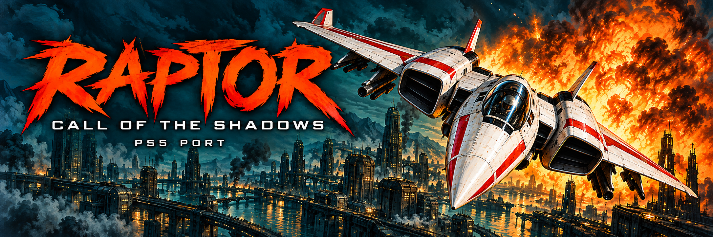

# RaptorPS5

Unofficial native PS5 port of **Raptor: Call of the Shadows**, based on skynettx’s SDL2 port.

## Download

Get the game package from [Releases](https://github.com/ChaDea1/RaptorPS5/releases). **v0.2.0-beta.4** is the current beta prerelease. The package includes no game data. On first launch, download free Apogee shareware or supply your own matching DOS game files.

## Compatibility

Tested on PS5 firmware **13.42**, with **kstuff** and **ShadowMountPlus v1.7beta4**. Other firmware versions are untested. Saves are working for both the Shareware version and while using the episode packs. Individual extra-episode have also been tested and are confirmed to be fully working.

## Install

1. Extract `raptor-ps5-v0.2.0-beta.4.zip`.
2. Copy the complete `PPSA94002` folder to `/data/homebrew/`.
3. Launch **Raptor: Call of the Shadows** from the dashboard.
4. Choose **Download free Apogee shareware** (Internet required once), or **Use my own game files**. Existing matching data works offline.

Close the game before updating. Back up existing pilot saves and configuration before replacing files.

## Full game

Copy your own matching DOS game GLBs (`FILE0000.GLB` through `FILE0004.GLB`, plus any others supplied) directly into `PPSA94002/content/`, or `/data/homebrew/PPSA94002/content/` after installation. Uppercase and lowercase canonical filenames work. Archives, installers and nested folders are not read. See `content/README.txt` in the package. Fully close and restart the game after changing content. Remove custom GLBs to return to downloaded shareware, if installed.

## NOTE

The OSK was implemented for inputting your pilot name and call sign when starting a new game. Use cross to highlight the name field and bring up the OSK. Input what you want, hit triangle to cycle to the callsign field, and hit triangle again to proceed to the difficulty selection popup. Circle backs out of the keyboard.

## DualSense controls

| Control | Action |
| --- | --- |
| Left stick / D-pad | Move |
| R2 / Cross | Fire |
| L1 / R1 / Circle | Cycle special weapons |
| Square / Triangle | Megabomb (requires inventory) |
| Touchpad click | Pause / resume |
| Short Options press | Abort confirmation / Back |
| Hold Options for 700 ms | Toggle keyboard |
| R3 | Toggle controls reference |

Keyboard: D-pad selects a key, Cross presses it, Square sends Backspace, Triangle sends Enter, and Circle closes. Keyboard and controls reference are mutually exclusive. The game continues while overlays are open; use touchpad to pause.

## Source and licensing

The release includes the modified source archive and SHA-256 checksums alongside the binary package. Source archive includes the Raptor port, modified PS5 SDL, native application toolkit, hooks and build scripts. Build requires the public PS5 payload SDK, LLVM/Clang, CMake and Make; the archive does not bundle the compiler or SDK. Existing workspace build scripts assume locally prepared dependencies.

Upstream license texts are retained in the source and game package. Raptor source is GPL-2.0-or-later; the native toolkit is GPL-3.0-or-later; SDL uses the zlib license; miniz and TinySoundFont use MIT licenses. This distribution elects GPL-3.0-or-later for its Nuked OPL3 copy under upstream LGPL-2.1 section 3; upstream remains LGPL-2.1-or-later. Font copyright and permission notices are retained. The binary package and corresponding-source archive include the notices in `native/licenses/`, including the dated PS5 modification record and source/rebuild guidance. Original game data retains its original rights and is separate from the source licenses. No registered/full-game assets are distributed.

## Credits

- [skynettx/raptor](https://github.com/skynettx/raptor), based on nukeykt’s reverse-engineered codebase.
- [ps5-payload-dev/SDL](https://github.com/ps5-payload-dev/SDL) and the public PS5 payload SDK.
- [blackbearreloaded/ps5-native-app-boilerplate](https://github.com/blackbearreloaded/ps5-native-app-boilerplate).
- Original Raptor creators and respective rights holders.

Dashboard artwork was AI-generated. This is an unofficial community port.
Created using Codex/ChatGPT. If you don't like that, then I'm sorry i guess? Not really though.

## Reporting problems

Open an issue with firmware, loader versions, reproduction steps, and whether you use downloaded shareware or your own full-game data. Do not upload copyrighted full-game data or private information.

## Beta status

Core gameplay, shareware and owned full-game episodes, audio, controls, overlays, saving/loading and Quit to dashboard have been confirmed by the owner on the tested setup. Wider console and firmware coverage is still needed before a stable release.

## Saves and updating

Both shareware and full-game pilots now use `/data/homebrew/PPSA94002/saves/`. The game creates the folder when needed. There are ten pilot slots shared between both modes. Configuration stays in the base app folder.

When upgrading from alpha:

1. Fully close Raptor and back up existing saves and configuration.
2. Replace `eboot.bin` from the new package. Keep your `content/`, `saves/` and `SETUP.INI`.
3. Copy existing `CHAR0000.FIL` through `CHAR0009.FIL` from the old app root or `content/` into `saves/`. Do not overwrite another pilot; use an unused slot filename if needed.
4. Restart and verify your pilots load. Retain the original files as backups until confirmed.

The update does not automatically migrate old pilot files. See `saves/README.txt` in the package. Quit Game now returns to the dashboard gracefully.

## First-launch data setup

Beta.4 distributes no GLBs, shareware ZIP, DOS executables or personal pilots. The optional, player-initiated shareware download comes from DOSGames.com over verified HTTPS. The complete downloaded ZIP is retained as `shareware-original.zip` beside `eboot.bin`; only the two pinned, SHA-256-verified GLBs are extracted into `/data/homebrew/PPSA94002/`. The package does not download registered/full-game content.

Your matching `content/` files take priority over downloaded shareware. Legacy data in `/data/raptor/` also remains supported. The old `/download0/raptor-shareware/` location is ignored. To bring setup back, remove the GLBs from the installed title root, `content/`, and any other supported data folder, then fully close and restart. Keep `saves/` to preserve your pilots. Keeping the original ZIP allows setup to reinstall verified shareware without another network download; the ZIP alone does not skip setup.

A six-second top-left popup reports shareware, the full game, or installed episode packs and lists playable sectors. Outer Regions requires both of its files; an incomplete pair is flagged. Download/install, removal/restart, and popup detection have been confirmed on the tested console.

## Catalog release metadata

Beta.4 ships `contentVersion` **00.005.000** and title ID **PPSA94002**. Committed `sce_sys/param.json` and `sce_sys/icon0.png` match the release package. The repository-level LICENSE is GPL-3.0 for the combined native port; individual upstream notices remain in the attached corresponding-source archive. Game data retains its original rights. No game data is distributed with beta.4.

## Beta.4 license-notice corrections

Beta.4 adds TinySoundFont's MIT notice, textscreen font attributions, the original Nuked OPL3 LGPL text for provenance, and an explicit GPLv3 election for the shipped OPL3 copy. It adds dated PS5 modification notices, a component notice summary and corresponding-source/rebuild guidance. See `licenses/` in the installed app and `native/licenses/` in the attached source archive. The executable and runtime are byte-for-byte identical to the console-tested beta.3; the content version and notices change.

The optional downloader is retained. These code-license corrections do not resolve the separate shareware/download permission questions or constitute publisher attestation. The publisher confirmation remains unchecked in the catalog submission.
